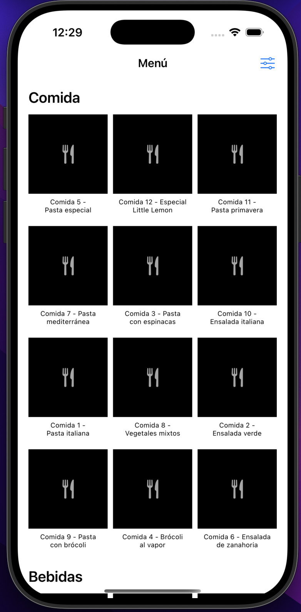
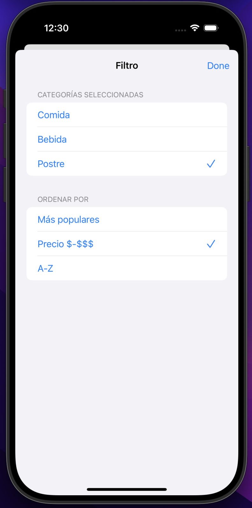
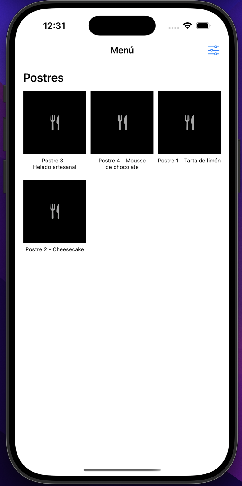
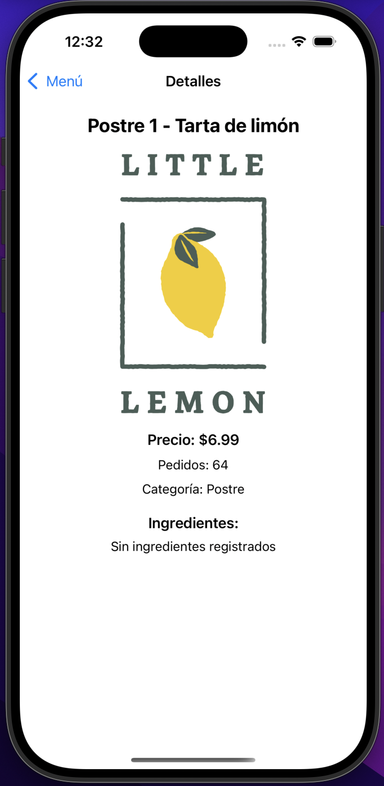

# 🍋 LittleLemonDinnerMenu

### Aplicación iOS de menú digital · Swift · SwiftUI · MVVM · XCTest

---

**LittleLemonDinnerMenu** es una aplicación nativa para iOS desarrollada con **Swift y SwiftUI**, que permite explorar el menú digital del restaurante Little Lemon. Incluye 24 productos distribuidos en comidas, bebidas y postres, filtrado por categorías, ordenación por popularidad, precio y nombre, además de navegación hacia los detalles de cada producto.

El proyecto implementa la arquitectura **MVVM**, modelos de datos, enumeraciones, protocolos y pruebas unitarias mediante **XCTest**, como parte del programa **Meta iOS Developer de Coursera**.

---

## 📱 Capturas de pantalla

<table>
  <tr>
    <td align="center">
      <strong>Menú principal</strong>
        
      
    </td>
    <td align="center">
      <strong>Filtrado y ordenación</strong>
        
      
    </td>
  </tr>
  <tr>
    <td align="center">
      <strong>Menú de postres</strong>
        
      
    </td>
    <td align="center">
      <strong>Detalles del producto</strong>
        
      
    </td>
  </tr>
</table>

